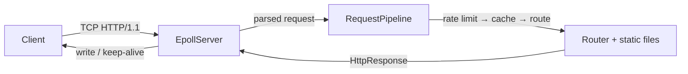

# C++17 Linux HTTP Server

Production-style **multithreaded / event-driven HTTP/1.1 server** in Modern C++ on Linux. Built incrementally to demonstrate systems programming: sockets, HTTP framing, concurrency, epoll, and backend middleware — suitable for a C++ backend / systems resume.

**Stack:** C++17 · CMake · GCC · Linux (`socket`, `epoll`, `fcntl`) · STL only (plus Google Test) · Docker

---

## Features

| Area | What ships |
|------|------------|
| Networking | TCP listen/accept, HTTP/1.1 parse + serialize, keep-alive, idle timeouts |
| Concurrency | Thread pool + move-only task queue **or** epoll event loop (default) |
| HTTP | Routing (`GET /health`), static files with MIME types and path-traversal checks |
| Middleware | Per-IP token-bucket rate limit, LRU+TTL response cache |
| Ops | Structured async logger, env/CLI config, SIGINT/SIGTERM shutdown |
| Quality | Google Test, stress/concurrency scripts, multi-stage Docker |

---

## Architecture

Default path: **epoll** (one event loop, non-blocking sockets). Optional: **thread pool** of blocking workers.



Deeper diagrams, tradeoffs, and “what this is not”: [docs/ARCHITECTURE.md](docs/ARCHITECTURE.md)

Interview talking points and resume bullets: [docs/INTERVIEW.md](docs/INTERVIEW.md)

---

## Quick start (Windows + Docker)

Prerequisites: **Docker Desktop running** (Linux containers / WSL2).

```powershell
cd "C:\Users\kumar\Desktop\Cpp Project\server"
docker compose -f docker/docker-compose.yml build
docker compose -f docker/docker-compose.yml run --rm -p 8080:8080 cpp-http-server bash
```

Inside the container:

```bash
cmake -S . -B build -DCMAKE_BUILD_TYPE=Debug -DBUILD_TESTS=ON
cmake --build build -j
./build/server 8080
```

From Windows:

```powershell
curl.exe http://127.0.0.1:8080/
curl.exe http://127.0.0.1:8080/health
curl.exe http://127.0.0.1:8080/style.css
```

Stop the server with **Ctrl+C**.

---

## Tests

```bash
chmod +x scripts/run_tests.sh
./scripts/run_tests.sh
```

Or:

```bash
ctest --test-dir build --output-on-failure
```

CI-style image (Release + `ctest`):

```bash
docker compose -f docker/docker-compose.yml --profile test build test
```

Stress (server already running):

```bash
chmod +x scripts/stress_test.sh
./scripts/stress_test.sh http://127.0.0.1:8080 200 25
```

Concurrency check (starts its own server):

```bash
chmod +x scripts/concurrency_test.sh
./scripts/concurrency_test.sh
```

---

## Production image

Multi-stage Dockerfile: **dev** (toolchain) → **builder** (compile + test) → **runtime** (binary + `static/`).

```bash
docker compose -f docker/docker-compose.yml --profile prod up --build server
```

---

## Configuration

CLI: `./build/server [port] [worker_threads]` (overrides env).

| Variable | Default | Description |
|----------|---------|-------------|
| `SERVER_PORT` | `8080` | Listen port |
| `SERVER_THREADS` | `4` | Worker count (`threadpool` mode) |
| `SERVER_STATIC_ROOT` | `static` | Static file root |
| `SERVER_LOG_LEVEL` | `INFO` | `DEBUG`, `INFO`, `WARN`, `ERROR` |
| `SERVER_IO_MODEL` | `epoll` | `epoll` or `threadpool` |
| `SERVER_ASYNC_LOG` | `true` | Background log thread |
| `SERVER_RATE_LIMIT_RPS` | `50` | Per-IP rate (`0` = off) |
| `SERVER_RATE_LIMIT_BURST` | `100` | Token-bucket burst |
| `SERVER_CACHE_MAX_ENTRIES` | `128` | Response cache size (`0` = off) |
| `SERVER_CACHE_TTL_SECONDS` | `60` | Cache TTL |
| `SERVER_REQUEST_TIMEOUT_SECONDS` | `30` | Idle timeout in epoll (`0` = off) |

```bash
export SERVER_LOG_LEVEL=DEBUG
export SERVER_IO_MODEL=epoll
./build/server 8080
```

---

## Project layout

```
include/     http, router, server, threadpool, logger, config, utils
src/         Matching .cpp files; main.cpp wires I/O + pipeline
tests/       Google Test
scripts/     run_tests.sh, stress_test.sh, concurrency_test.sh
static/      index.html, style.css
docs/        Architecture and interview notes
docker/      compose (dev / test / prod profiles)
Dockerfile   Multi-stage Linux image
```

---

## Design choices (short)

- **RAII** for sockets (`UniqueFd`); no leaked fds on error paths.
- **Move-only tasks** in the thread pool so workers can own client sockets (`std::function` cannot).
- **Epoll LT** + connection read/write buffers so HTTP requests can arrive in fragments.
- **Rate limit before cache** so attackers cannot bypass the limiter via cached GETs.

---

## Status

Phases 1–8 complete: TCP → HTTP → thread pool → static/log/config → epoll/keep-alive → middleware → tests/Docker → documentation.

Not in scope: TLS, HTTP/2, chunked encoding, production hardening comparable to nginx.
