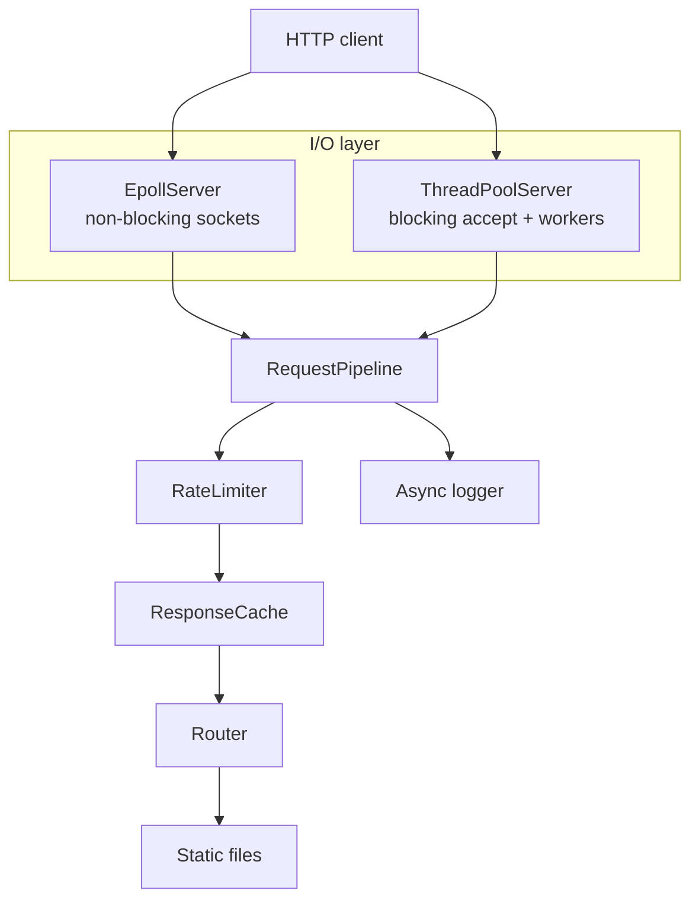
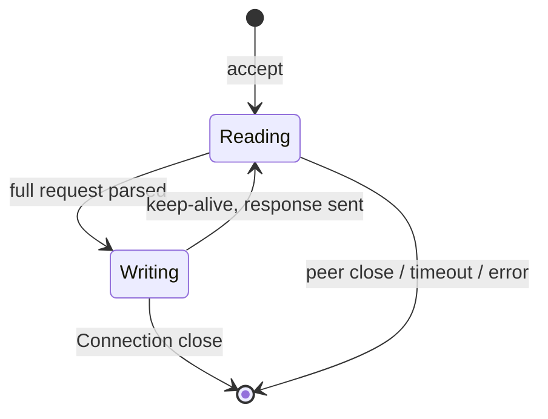

# Architecture

This document describes how the server is structured, why those choices were made, and what they imply for performance.

## High-level view

Default I/O model is **epoll**. Set `SERVER_IO_MODEL=threadpool` to use the Phase 3 blocking worker pool instead.

## Request path (epoll)

1. `epoll_wait` reports events on the listen socket or a client fd.
2. **Accept** loops until `EAGAIN` (non-blocking `accept`).
3. **Read** appends into a per-connection buffer until `complete_request_size()` says a full HTTP request is present.
4. The request is parsed and passed to `RequestPipeline`.
5. **Write** sends the serialized response; if the socket is not ready, the connection stays in `Writing` until `EPOLLOUT`.
6. **Keep-alive**: if `Connection: keep-alive` (or HTTP/1.1 default), the fd goes back to `Reading`. Otherwise it is closed.
7. **Idle timeout**: connections with no I/O for `SERVER_REQUEST_TIMEOUT_SECONDS` are closed.

## Middleware pipeline

Order is fixed and intentional:

| Step | Component | Effect |
|------|-----------|--------|
| 1 | Rate limiter | Token bucket per client IP. Excess → `429`. |
| 2 | Cache lookup | `GET` only. Hit skips the router. |
| 3 | Router | Exact routes (`GET /health`) then static-file fallback. |
| 4 | Cache store | Stores cacheable `200` GET responses (text, JSON, JS, images). |

Rate limiting runs **before** cache so abusive clients cannot fill the cache or skip the limiter via repeated GETs.

## Concurrency models

| Model | Threads | Sockets | Best for |
|-------|---------|---------|----------|
| `epoll` | 1 event loop + async log thread | Non-blocking | Many idle/keep-alive connections |
| `threadpool` | N workers | Blocking `recv`/`send` | Simpler reasoning, fewer connections |

Tradeoff: epoll is more code (connection state machines, partial reads/writes) but avoids one thread per connection. The thread pool is easier to debug and still useful as a comparison point.

## Resource management

- File descriptors are owned by `utils::UniqueFd` (RAII).
- Thread-pool tasks are **move-only** (`ITask` / `std::unique_ptr`) so a lambda can own a `UniqueFd`. `std::function` cannot hold move-only types.
- The logger queue is drained on `logger::shutdown()` so Ctrl+C does not lose the last lines.

## Security notes (static files)

`serve_static` rejects `..` in the URL and checks that `weakly_canonical` of the resolved path stays under `static_root`. That is the minimum needed to avoid directory traversal; it is not a full WAF.

## What this is not

This is a **learning / portfolio** server, not a replacement for nginx or a production HTTP stack. It does not implement TLS, HTTP/2, chunked transfer encoding, or request pipelining beyond buffering extra bytes on a keep-alive connection.
